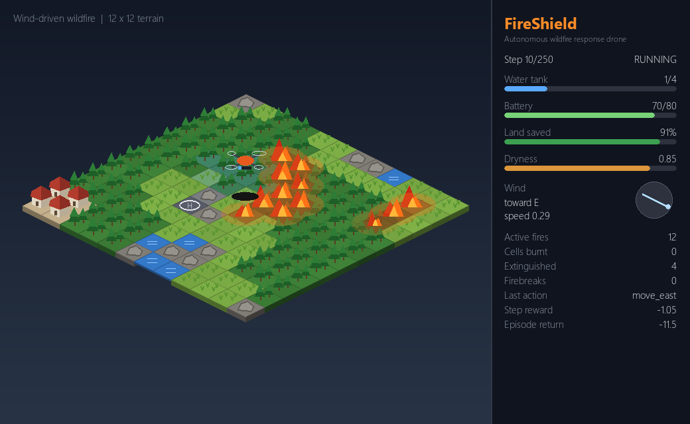
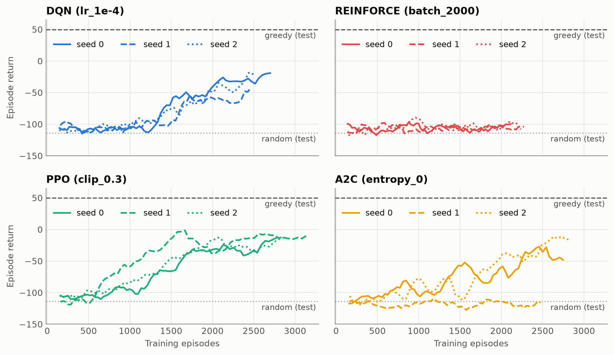
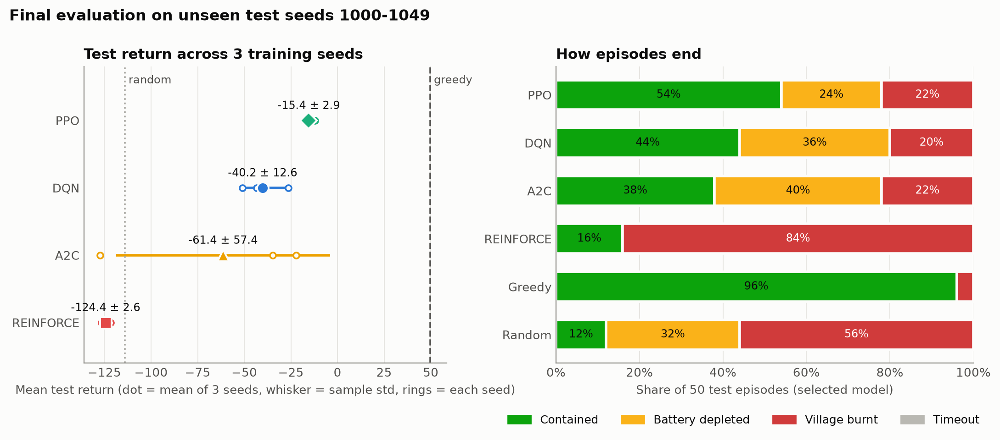
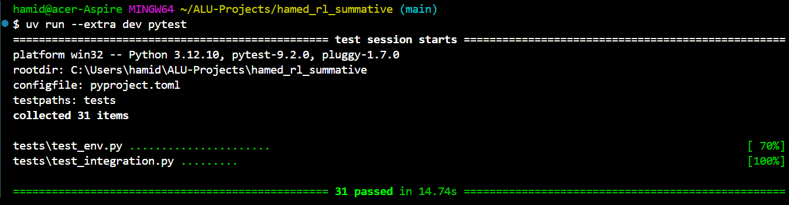

# FireShield: Wildfire Response Drone

FireShield is a reinforcement learning project about wildfire response. An autonomous drone with a limited water tank and battery must put out a spreading, wind-driven fire before it reaches a village, while saving as much land as possible.

Fire spreads randomly, burnt land stays burnt, and some choices pay off only later: flying back to refill gives the fire time to grow. That makes it a sequential decision problem under uncertainty, which suits reinforcement learning.

Four TorchRL agents (**DQN, REINFORCE, PPO and A2C**) are trained and compared on the same custom Gymnasium environment, with 11 hyperparameter experiments per algorithm.



> - **[Watch the Demo video](https://screenpal.com/watch/cOXODJn4LsJ)** 
> - **[Watch the trained PPO agent Simulation](https://youtu.be/5-06o4qzEuM)** 
> - **[Full experiment tables and analysis](experiments.md)**

## Project Structure
```text
hamed_rl_summative/
├── pyproject.toml
├── uv.lock
├── README.md
├── experiments.md           # experiment logic, per-algorithm tables, results
├── main.py                  # CLI: play (default), train, sweep, finalize, evaluate, plots, export, serve, client-demo, record
├── play.py                  # shortcut for `main.py play`
├── environment/
│   ├── __init__.py          # registers FireShield-v0
│   ├── custom_env.py        # Gymnasium FireShieldEnv (fire dynamics, rewards, observations)
│   ├── rendering.py         # Pygame 2.5D isometric renderer + HUD
│   ├── recording.py         # MP4 recorder
│   └── baselines.py         # random and greedy reference policies
├── training/
│   ├── __init__.py
│   ├── common.py            # shared env factory, MLPs, evaluation, logging, checkpoints
│   ├── dqn_training.py      # TorchRL DQN + phase-1 sweep definition
│   ├── pg_training.py       # TorchRL REINFORCE, PPO, A2C + phase-1 sweep definitions
│   ├── sweep.py             # two-phase sweep, robustness runs, final selection
│   └── plots.py             # report figures + generalization evaluation
├── integration/
│   ├── policy.py            # FireShieldPolicy (checkpoint / TorchScript / NumPy) + JSON state -> obs
│   ├── export.py            # export + cross-format verification
│   ├── server.py            # JSON inference API (standard library http.server)
│   └── client_demo.py       # drone simulator controlled through the API
├── models/
│   ├── dqn/                 # dqn_<run>.pt, dqn_best.pt
│   ├── pg/                  # {reinforce,ppo,a2c}_<run>.pt, *_best.pt
│   └── export/              # policy.torchscript.pt, policy_weights.npz, policy_card.json
├── logs/                    # per-run config.json, metrics.csv, summary.json; sweep tables
├── assets/                  # agent_env/ screenshot + video, plots/ figures and tables
└── tests/                   # environment + integration tests (uv run --extra dev pytest)
```

## Quick Start

You need [Git](https://git-scm.com/downloads) and [uv](https://docs.astral.sh/uv/getting-started/installation/). uv creates the virtual environment and installs the dependencies, including a suitable Python version if needed.

1. Clone the repository:
   ```bash
   git clone https://github.com/hd77alu/hamed_rl_summative.git
   ```
2. Go to the project directory:
   ```bash
   cd hamed_rl_summative
   ```
3. Install the dependencies:
   ```bash
   uv sync
   ```
4. Run the best-trained agent:
   ```bash
   uv run main.py
   ```

This opens the simulation window and plays six test episodes with the trained PPO model, printing every step in the terminal and a summary at the end. The models are included, so no training is needed. `uv run play.py` does the same.

## Environment

| Part | Summary |
|---|---|
| World | 12×12 grid with forest, grass, rock, water, a village and a base. Wind and dryness affect fire spread |
| Agent | One drone with 4 water drops and 80 battery units, both restored at the base |
| Actions | 9 discrete actions, listed below |
| Observations | 65 values: 5×5 fire and fuel windows, drone position, water, battery, wind, dryness, directions to the nearest fire and base, village threat, shares of the map burning and burnt |
| Rewards | +0.5 per cell extinguished, −1 per new ignition, small costs for time and wasted actions, +50 plus up to +50 for land saved when the fire is out, −50 if the village ignites, −20 if the battery runs out, plus distance-based shaping |
| Episode ends | All fires out, village ignites, battery empty, or 250 steps |

### Actions

The agent has 9 discrete actions, as follows:

| Action | Description |
|---|---|
| Move North | Move one step north. |
| Move South | Move one step south. |
| Move East | Move one step east. |
| Move West | Move one step west. |
| Drop Water | Use one unit of water to extinguish fire on the current cell and its four adjacent cells, and wet them to resist re-ignition. |
| Build Firebreak | Remove the fuel from the current cell, if it is unburnt vegetation, so fire cannot spread through it. |
| Return to Base | Move one step toward the base, or refill water and battery if already there. |
| Hover and Scan | Stay in place for one step. No extra information is gained. |
| Fly to Nearest Fire | Automatically move one step toward the nearest burning cell on the map. |

Every action takes one step and uses one unit of battery, except refilling at the base, which uses no battery. Moving off the map leaves the drone in place with a −0.1 penalty.

## Final Results

Return on 50 unseen test episodes (seeds 1000–1049). The test return is the mean over three training seeds ± sample standard deviation. The last three columns are for the selected seed-0 model.

| Method | Selected setting | Test return (3 seeds) | Contained | Village burnt | Battery empty |
|---|---|---|---|---|---|
| **PPO** | clip 0.3 | **−15.4 ± 2.9** | 54% | 22% | 24% |
| DQN | learning rate 1e-4 | −40.2 ± 12.6 | 44% | 20% | 36% |
| A2C | entropy coefficient 0 | −61.4 ± 57.4 | 38% | 22% | 40% |
| REINFORCE | 2,000 steps per update | −124.4 ± 2.6 | 16% | 84% | 0% |
| *Greedy heuristic* | hand-coded | +49.7 | 96% | 4% | 0% |
| *Random policy* | – | −114.0 | 12% | 56% | 32% |



### Discussion

- **PPO** is the best and most repeatable method: all three seeds learned, with a small spread. Combining its best settings, tested with one seed, collapsed into a policy that rarely fights the fire.
- **DQN** also learned in every seed, but later and with large swings between checkpoints. Learning rate had the clearest effect, with the lowest value performing best.
- **A2C** depends on the seed: two learned, and one collapsed. Removing the entropy bonus was the only change that clearly worked.
- **REINFORCE** did not learn a useful policy. Its selected model simply returns to base, and its underlying policy stayed close to uniform. Likely causes are noisy Monte Carlo gradients and few updates.
- **Generalization:** PPO stays the best learned agent when fire spreads faster, starts in more places, or meets stronger wind. Faster spread and more ignitions lowered every score; stronger wind did not.
- **Reading "contained":** some fires burn out on their own. Always returning to base contains 22% of validation fires without using any water.



### Limitations

- Each sweep experiment used one training seed, so close results are not reliable differences.
- Only final checkpoints were scored, with deterministic actions, which can hide partial learning.
- The budget was 150,000 steps per experiment. The conclusions apply to that budget and these settings.

## Tests

There are 31 automated tests. No trained models are needed to run them.

- **Environment (22):** Gymnasium API compliance, start state, reproducibility with a fixed seed, water drops, firebreaks, refilling, reward shaping, episode endings, rendering, and the greedy policy beating the random one.
- **Integration (9):** converting the drone state to JSON and back, rejecting invalid input, agreement between the exported model formats, and the HTTP API.

```bash
uv run --extra dev pytest
```


## Integration: Using the Trained Policy Outside Training
```bash
uv run main.py export         # best model -> models/export/ (TorchScript + NumPy weights + policy card)
uv run main.py serve          # JSON inference API on http://127.0.0.1:8000
uv run main.py client-demo    # simulated drone flies 3 episodes, every action comes from the API
```
- **Serialization:** the training checkpoint (`models/pg/ppo_best.pt`) is exported to `policy.torchscript.pt` (needs only PyTorch) and `policy_weights.npz` (needs only NumPy, which suits an on-board computer or a mobile/web client). `policy_card.json` describes the inputs and outputs: the observation layout, action names and test metrics. During export, all three formats must choose the same action on 200 test observations.
- **API:** `GET /health`, `GET /spec`, `GET /example`, `POST /act`. A drone posts its world state as JSON and gets back an action:
  ```json
  POST /act  {"state": {"drone": [7, 4], "base": [7, 4], "village_cells": [[10, 0], ...], "water": 4,
                        "battery": 80, "wind": {"direction": "N", "speed": 0.82}, "dryness": 0.95,
                        "fire_intensity": [[...12x12...]], "fuel": [[...12x12...]], "burnt": [[...]]}}
  -> {"action": 8, "action_name": "fly_to_fire", "confidence": 0.979, "probabilities": {...}, "latency_ms": 1.8}
  ```
  The API converts the state to an observation with the environment's own code, so a real controller and the simulator always see identical inputs. Requests can also send the raw 65-value `observation`. Invalid input returns HTTP 422 with an error message. The server uses only the Python standard library, so it adds no dependencies.
- **End-to-end check:** `client-demo` runs whole episodes over HTTP. Measured: 103 decisions with 0 mismatches against the local checkpoint and a median round trip of ~4 ms. The outcomes match `main.py play` exactly.
