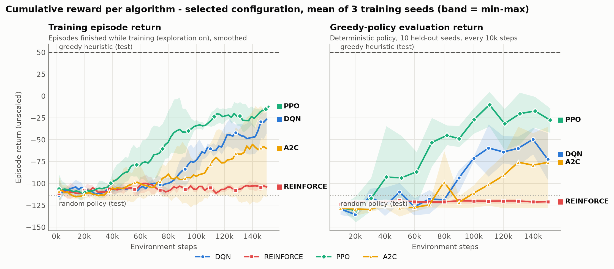
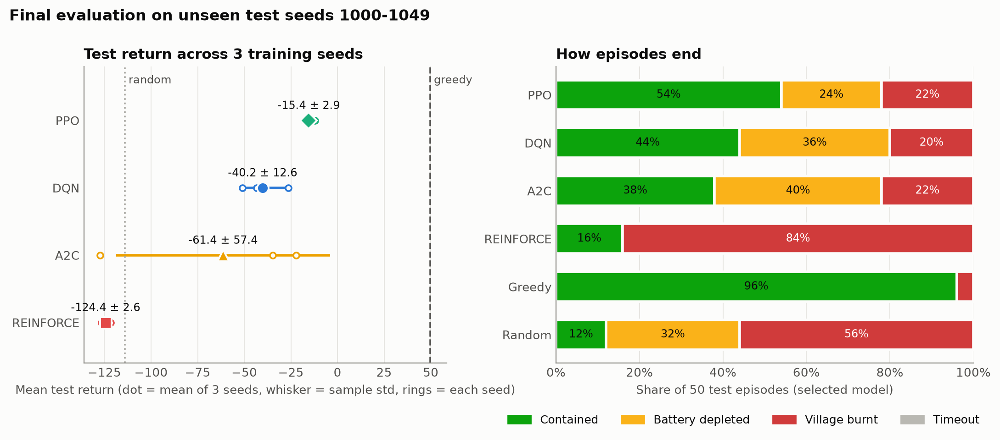
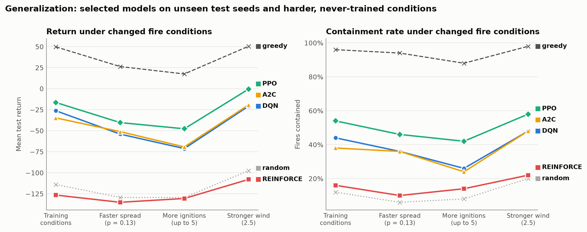

# FireShield Experiments

This document explains how the four algorithms (DQN, REINFORCE, PPO, A2C) were tuned on the FireShield environment, what each experiment tested, and what the trained agents did.

**Main results**
- PPO with clip 0.3 is the best and most repeatable agent: −15.4 ± 2.9 test return over three training seeds.
- DQN with learning rate 1e-4 is second: −40.2 ± 12.6. It learned in all three seeds, but less consistently than PPO.
- A2C with entropy coefficient 0 is third: −61.4 ± 57.4. It learned in two of three seeds and collapsed in the other, so it depends heavily on the training seed.
- REINFORCE with 2,000 steps per update is last: −124.4 ± 2.6. It did not learn a useful policy in any seed and scores slightly below the random policy (−114.0).

## 1. Experiment logic

### Setup shared by all experiments

| Control | Value |
|---|---|
| Environment | `FireShield-v0`: 12×12 grid, 65 observations, 9 discrete actions |
| Budget | 150,000 environment steps per experiment (PPO can finish slightly over, at a full rollout) |
| Network | MLP, two hidden layers of 128 units, ReLU. PPO, A2C and the REINFORCE baseline use a separate critic of the same size |
| Reward scaling | ×0.05 during learning only. All rewards below are in original units |
| Training seed | 0 for every sweep experiment |
| Evaluation | Final checkpoint, deterministic (argmax) actions, one episode per seed |
| Validation seeds | 500–549, used to rank experiments and choose the final configuration |
| Test seeds | 1000–1049, reported only, never used to choose an experiment |

### Three phases

1. **Experiments 1–9, one change at a time.** Experiment 1 is the baseline. Experiments 2–9 each change one setting, so a difference can be linked to that setting.
2. **Experiments 10–11, combinations.** Experiment 10 combines the two best changes by validation reward, and experiment 11 the three best. If two changes affect the same setting, the better one is kept.
3. **Robustness.** The best of the 11 experiments is retrained with seeds 1 and 2.

This gives 44 sweep experiments and 8 robustness experiments.

### How to read the tables

- **★** marks the selected experiment and **bold** settings differ from the baseline.
- **Mean reward** is the average return over 50 episodes; ± is the standard deviation between episodes. The standard error is about ±15 for experiments that learned and ±7 for experiments that did not, so small gaps are not meaningful.
- **Contained** means no fire was left. Fires can burn out on their own, so this is not always the agent's work.
- **Empty drop** means using `drop_water` with no water. Drop, refill and action figures come from replaying each saved model on the validation seeds. "Sampled" scores draw actions from the policy instead of taking argmax.
- Explanations of *why* a setting helped are hypotheses, since each sweep experiment used one training seed.

### Reference policies (validation seeds)

| Policy | Mean reward | Contained | What it shows |
|---|---|---|---|
| Greedy heuristic | +37.6 | 94% | Refills in 33 of 50 episodes, no empty drops |
| Random | −118.0 | 10% | No skill |
| Always hover | −117.6 | 4% | Doing nothing |
| Always fly to fire | −117.9 | 4% | Reaching the fire without dropping is no better than hovering |
| Always return to base | −113.3 | 22% | Refuelling at base avoids battery failure, and some fires burn out by themselves |

Any experiment scoring around −113 to −125 therefore shows no useful firefighting, even if its containment is 22%.

## 2. DQN

Fixed for every experiment: one update per 4 steps, learning starts at 2,000 steps, smooth L1 loss. The ε decay begins after learning starts.

| Experiment Number | Learning Rate | Gamma | Replay Buffer Size | Batch Size | Exploration Strategy | Target Network | Mean Reward (validation ± std) | Mean Reward (test) | Contained (validation) | Justification | Observations |
|---|---|---|---|---|---|---|---|---|---|---|---|
| 1 | 0.0005 | 0.99 | 50,000 | 128 | ε-greedy 1.0→0.05 over 50k steps | hard, every 500 updates | −74.7 ± 101 | −78.5 | 30% | Reference point: common DQN defaults. | Learns part of the task, late: evaluation stays near −110 to −135 until about 130k steps. 58% of villages burn. Uses little water (2.1 drops per episode) and hovers or moves without dropping much of the time. |
| **2 ★** | **0.0001** | 0.99 | 50,000 | 128 | ε-greedy 1.0→0.05 over 50k steps | hard, every 500 updates | −30.2 ± 109 | −26.3 | 44% | Smaller steps may steady bootstrapped Q-targets. | **Best DQN experiment.** Evaluation rises from about −118 at 80k to −42 at 150k. Attacks fires (7.8 drops per episode), but 60% of drops are made with an empty tank and it refills in only 1 of 50 episodes. |
| 3 | **0.001** | 0.99 | 50,000 | 128 | ε-greedy 1.0→0.05 over 50k steps | hard, every 500 updates | −121.5 ± 60 | −124.8 | 10% | Test whether faster learning helps in a short budget. | Worst DQN experiment, at random level. Evaluation never rises above −99; 72% of drops use an empty tank. With experiment 2, this suggests the default rate is already too high. |
| 4 | 0.0005 | **0.95** | 50,000 | 128 | ε-greedy 1.0→0.05 over 50k steps | hard, every 500 updates | −113.0 ± 64 | −77.7 | 8% | Shorter horizon: lower-variance targets, less weight on the final outcome. | Unstable: −43 at 130k, then −134 at 150k, so the final-checkpoint score is partly a matter of timing (validation −113, test −78). 71% of drops are empty. |
| 5 | 0.0005 | 0.99 | 50,000 | 128 | **ε-greedy 1.0→0.05 over 20k steps** | hard, every 500 updates | −52.2 ± 105 | −50.0 | 44% | Exploit earlier, leaving more of the budget for learning from good behaviour. | Second-best single change. Most of the gain comes after 100k (−38 at 150k). Lowest battery-failure rate among DQN experiments (10%) and refills in 14 of 50 episodes. |
| 6 | 0.0005 | 0.99 | 50,000 | 128 | **ε-greedy 1.0→0.05 over 100k steps** | hard, every 500 updates | −60.4 ± 101 | −61.5 | 38% | Explore longer, in case the fly–drop–refill sequence needs more discovery. | Better than baseline on validation, but the curve is flat near −100 to −140 throughout. The 10 progress seeds and 50 validation seeds disagree (−110 vs −60), so treat the gain cautiously. |
| 7 | 0.0005 | 0.99 | **10,000** | 128 | ε-greedy 1.0→0.05 over 50k steps | hard, every 500 updates | −62.0 ± 107 | −78.7 | 30% | Fresher replay data, closer to the current policy. | Late improvement (−133 at 110k to −49 at 150k), but never refills. Test return equals the baseline's (−79), so the validation gain did not carry over. |
| 8 | 0.0005 | 0.99 | 50,000 | 128 | ε-greedy 1.0→0.05 over 50k steps | **soft, τ 0.01** | −96.4 ± 86 | −72.2 | 22% | Smooth target updates instead of periodic copies. | No clear benefit: −96 on validation, −72 on test. Evaluation on progress seeds never rises above −117. Many empty drops (52%). |
| 9 | 0.0005 | 0.99 | 50,000 | 128 | ε-greedy 1.0→0.05 over 50k steps | **hard, every 500 updates + double DQN** | −95.4 ± 82 | −83.1 | 28% | Reduce over-estimation of Q-values. | No clear benefit (−95 / −83 on test). More refilling than most (18 of 50 episodes), yet 58% of villages still burn. Over-estimation does not appear to be the main limit. |
| 10 | **0.0001** | 0.99 | 50,000 | 128 | **ε-greedy 1.0→0.05 over 20k steps** | hard, every 500 updates | −32.4 ± 112 | −31.9 | 46% | Combine the two best single changes: lr 1e-4 and ε-decay 20k. | Ties experiment 2 within noise (−32 vs −30). Most efficient water use of the strong experiments (17% empty drops) and the best DQN test containment (48%). Still noisy between checkpoints. |
| 11 | **0.0001** | 0.99 | **10,000** | 128 | **ε-greedy 1.0→0.05 over 20k steps** | hard, every 500 updates | −39.1 ± 112 | −33.3 | 38% | Add the third-best change: buffer 10k. | Slightly lower than experiment 10, within noise. Learns earlier (−29 at 70k) but then falls back, and it never refills. The small buffer may be forgetting useful experience. |

**Summary.** Learning rate had the clearest effect: lowering it gave the best experiment and raising it the worst. Faster ε decay also helped. Most experiments improved only after about 90k steps and moved sharply between checkpoints, so the final-checkpoint score carries some luck. Combining the best changes gave no measurable gain over experiment 2.

## 3. REINFORCE

Fixed for every experiment: Monte Carlo returns, gradient clipping at 1.0.

| Experiment Number | Learning Rate | Gamma | Steps per Update | Return Normalisation | Value Baseline | Entropy Coef. | Mean Reward (validation ± std) | Mean Reward (test) | Contained (validation) | Justification | Observations |
|---|---|---|---|---|---|---|---|---|---|---|---|
| 1 | 0.001 | 0.99 | 500 | on | off | 0.01 | −113.7 ± 50 | −117.9 | 10% | Reference point: normalised returns, light entropy bonus. | The argmax policy hovers 100% of the time. Entropy is 2.13 of a possible 2.20, so the policy is still close to uniform. |
| 2 | **0.0003** | 0.99 | 500 | on | off | 0.01 | −116.9 ± 62 | −130.3 | 18% | Smaller steps to tame noisy Monte Carlo gradients. | Slowest change: entropy 2.19. The argmax policy returns to base (59%) or moves west (40%) and never drops water. Its 18% containment is fires burning out naturally. |
| 3 | **0.003** | 0.99 | 500 | on | off | 0.01 | −116.4 ± 49 | −120.6 | 8% | Larger steps to make progress in few updates. | **The only REINFORCE experiment with a visible learning signal.** Entropy falls to 1.60 and training return reaches about −85. Sampled actions score −89 (18% contained), but argmax (83% fly_to_fire, no drops) scores −116, so the table hides it. |
| 4 | 0.001 | **0.95** | 500 | on | off | 0.01 | −116.8 ± 57 | −123.5 | 6% | Shorter horizon to reduce return variance. | No learning (entropy 2.19). The argmax policy mostly moves west; sampled actions score −109, near random. |
| 5 | 0.001 | 0.99 | 500 | on | **on** | 0.01 | −123.2 ± 47 | −127.2 | 4% | A learned value baseline should reduce gradient variance. | No benefit: argmax moves west 100% of the time. The critic had few updates to learn from, which may be why it did not help. |
| 6 | 0.001 | 0.99 | 500 | **off** | off | 0.01 | −121.5 ± 64 | −135.5 | 22% | Check whether normalising returns distorts the signal. | No learning. The 22% containment comes from waiting at base (73%) or requesting firebreaks (27%), with no water used, so the outcome is mostly natural burn-out. |
| 7 | 0.001 | 0.99 | 500 | on | off | **0** | −117.9 ± 47 | −121.6 | 4% | Remove the push towards random actions. | Entropy still 2.14, so the bonus was not what kept the policy uniform; the gradient itself is weak. Argmax flies to the fire and never drops. |
| 8 | 0.001 | 0.99 | 500 | on | off | **0.05** | −117.6 ± 47 | −121.3 | 4% | Stronger exploration. | Entropy 2.19, effectively uniform. Argmax hovers 100%. |
| **9 ★** | 0.001 | 0.99 | **2000** | on | off | 0.01 | −113.3 ± 65 | −126.6 | 22% | More episodes per update for a less noisy gradient. | **Selected, but not because it learned.** The policy is return_to_base 100% and never drops water. It scores −113 because it cannot run out of battery at base. Only 75 updates fit in the budget. |
| 10 | **0.003** | 0.99 | **2000** | on | off | 0.01 | −122.8 ± 47 | −126.8 | 4% | Combine batch 2000 and lr 3e-3. | Worse than either (−123): moves east 97%. Larger batches cut the number of updates, undoing the benefit of the higher rate. |
| 11 | **0.003** | **0.95** | **2000** | on | off | 0.01 | −117.9 ± 47 | −121.6 | 4% | Add gamma 0.95. | Same score as a constant fly_to_fire policy (−117.9), and that is what argmax does. Sampled actions score −108. |

**Summary.** No configuration produced a useful deterministic policy. Entropy stayed at 2.06–2.19 in ten of eleven experiments (uniform is 2.20), so argmax picks a nearly arbitrary action and many experiments reduce to one repeated action. The rankings are within noise, and experiment 9 was selected for waiting at base. Experiment 3 is the exception: its sampled policy improved to about −89, which suggests a higher learning rate with a larger budget is the direction to try. Likely causes are high-variance Monte Carlo returns over roughly 60-step episodes and few updates (about 300 at 500 steps each, 75 at 2,000).

## 4. PPO

Fixed for every experiment: gamma 0.99, 10 epochs, minibatch 256, normalised advantages, gradient clipping at 0.5.

| Experiment Number | Learning Rate | Clip ε | Rollout Steps | GAE λ | Entropy Coef. | Value Coef. | Mean Reward (validation ± std) | Mean Reward (test) | Contained (validation) | Justification | Observations |
|---|---|---|---|---|---|---|---|---|---|---|---|
| 1 | 0.0003 | 0.2 | 2048 | 0.95 | 0.01 | 0.5 | −116.6 ± 51 | −115.3 | 12% | Reference point: common PPO defaults. | Little learning in 150k steps: random-level return, entropy still 1.61. Wanders and hovers. |
| 2 | **0.0001** | 0.2 | 2048 | 0.95 | 0.01 | 0.5 | −100.5 ± 78 | −100.4 | 12% | Smaller steps for stability. | Slightly better than baseline. Learns to fly to the fire (76%) and drop, but 66% of drops are empty, it never refills, and battery fails in 36% of episodes. |
| 3 | **0.001** | 0.2 | 2048 | 0.95 | 0.01 | 0.5 | −81.0 ± 85 | −54.1 | 20% | Larger steps for a short budget. | Improves to −81 (test −54). Uses many actions, but evaluation swings between −91 and −125, so it is not stable. |
| 4 | 0.0003 | **0.1** | 2048 | 0.95 | 0.01 | 0.5 | −77.6 ± 90 | −91.6 | 22% | Tighter clip: more conservative updates. | Better than baseline on validation (−78), weaker on test (−92). Entropy stays high (1.94). Spends 24% of actions on firebreaks. |
| **5 ★** | 0.0003 | **0.3** | 2048 | 0.95 | 0.01 | 0.5 | −21.1 ± 116 | −16.4 | 50% | Looser clip: let each update move the policy further. | **Best experiment of the whole study.** Evaluation climbs from −124 at 60k to around −10 from 110k. 50% contained. Flies to the fire and drops (7.8 drops per episode), but 56% of drops are empty and it refills in only 8 of 50 episodes. |
| 6 | 0.0003 | 0.2 | 2048 | **0.8** | 0.01 | 0.5 | −119.9 ± 47 | −122.2 | 4% | Lower-variance, more biased advantages. | Failed (−120). Moves east 39% and flies to fire 26%, with few useful drops. Delayed outcomes may need the longer credit horizon of λ 0.95. |
| 7 | 0.0003 | 0.2 | **512** | 0.95 | 0.01 | 0.5 | −28.0 ± 113 | −28.4 | 44% | Four times more frequent policy refreshes; same gradient steps per environment step. | Second best (−28). Learns fly (44%), move south (30%) and drop, but never refills. Progress evaluation fell from −15 to −64 near the end. |
| 8 | 0.0003 | 0.2 | 2048 | 0.95 | **0.05** | 0.5 | −59.0 ± 110 | −44.7 | 32% | More exploration to discover the refill trip. | Improves to −59 but does not discover refilling (2 of 50 episodes). 75% of drops are empty: the bonus adds random drops rather than better ones. |
| 9 | 0.0003 | 0.2 | 2048 | 0.95 | 0.01 | **1.0** | −42.0 ± 113 | −48.4 | 40% | Better critic, so better advantages. | Third best (−42). Curve improves from about 70k, with dips. Never refills; 65% of drops are empty. |
| 10 | 0.0003 | **0.3** | **512** | 0.95 | 0.01 | 0.5 | −119.0 ± 48 | −122.7 | 4% | Combine clip 0.3 and rollout 512. | **Collapsed** (−119). Entropy falls to 0.38: hover 62%, move east 23%, move south 15%. Never drops water. The two best changes did not add up. |
| 11 | 0.0003 | **0.3** | **512** | 0.95 | 0.01 | **1.0** | −120.6 ± 47 | −121.9 | 4% | Add value coefficient 1.0. | **Collapsed** (−121), entropy 0.67: mostly movement, 2.3 drops per episode. Adding the third change did not rescue experiment 10. |

**Summary.** Clip 0.3, rollout 512 and value coefficient 1.0 each helped strongly on their own, but both combinations collapsed into near-deterministic policies that rarely or never drop water. A possible cause is a looser clip acting on advantages estimated from only 512 steps, which are noisier. Rollout 512 does not add gradient steps per environment step (20 per 512 equals 80 per 2,048), so extra updates do not explain it. Both combinations were run with one seed, so this is not proof that the settings always conflict.

## 5. A2C

Fixed for every experiment: gamma 0.99, gradient clipping at 0.5, advantages not normalised.

| Experiment Number | Learning Rate | Rollout Steps | GAE λ | Entropy Coef. | Value Coef. | Mean Reward (validation ± std) | Mean Reward (test) | Contained (validation) | Justification | Observations |
|---|---|---|---|---|---|---|---|---|---|---|
| 1 | 0.0007 | 16 | 0.95 | 0.01 | 0.5 | −101.7 ± 69 | −106.3 | 10% | Reference point: common A2C defaults. | Slight learning: prefers fly_to_fire (54%) but rarely drops (2.9 per episode). Never refills, and battery fails in 38% of episodes. |
| 2 | **0.0003** | 16 | 0.95 | 0.01 | 0.5 | −101.7 ± 70 | −106.0 | 10% | Smaller steps for noisy short rollouts. | Same score as baseline. fly_to_fire 96%, 1.4 drops per episode: reaches the fire but does not fight it. |
| 3 | **0.002** | 16 | 0.95 | 0.01 | 0.5 | −117.9 ± 47 | −121.6 | 4% | Larger steps for a short budget. | Same score as a constant fly_to_fire policy (−117.9). Flies to the fire and never drops. |
| 4 | 0.0007 | **5** | 0.95 | 0.01 | 0.5 | −104.4 ± 72 | −99.6 | 10% | More frequent updates. | No clear change from baseline. Drops more (4.9 per episode), but never refills and progress evaluation ends at −138. |
| 5 | 0.0007 | **64** | 0.95 | 0.01 | 0.5 | −117.7 ± 47 | −121.6 | 4% | Longer rollouts give better advantage estimates. | Argmax flies and almost never drops (−118). Sampled actions drop 11.8 times per episode and score −95, so some learning is hidden by argmax. |
| 6 | 0.0007 | 16 | **1.0** | 0.01 | 0.5 | −122.0 ± 47 | −126.0 | 4% | Pure n-step returns: less bias, more variance. | No learning (−122): moves east 83%. The added variance did not pay off. |
| **7 ★** | 0.0007 | 16 | 0.95 | **0** | 0.5 | −42.0 ± 109 | −34.8 | 36% | Remove the entropy bonus, which may outweigh the small scaled rewards. | **Only A2C experiment that clearly learned.** Simple rule: fly_to_fire 88%, drop_water 12%. Never refills, so battery fails in 28% of episodes. |
| 8 | 0.0007 | 16 | 0.95 | **0.05** | 0.5 | −119.6 ± 47 | −123.1 | 4% | Stronger exploration. | Entropy 2.13, close to uniform. Never drops water. Opposite result to experiment 7, which fits the entropy-scale hypothesis. |
| 9 | 0.0007 | 16 | 0.95 | 0.01 | **1.0** | −122.8 ± 47 | −127.0 | 4% | Better critic, so better advantages. | No learning (−123): moves east 96%. |
| 10 | **0.0003** | 16 | 0.95 | **0** | 0.5 | −124.3 ± 47 | −124.1 | 4% | Combine entropy 0 and lr 3e-4. | **Collapsed** (−124): moves west 95%. Only experiment 7 was a real signal; lr 3e-4 tied with the baseline. |
| 11 | **0.0003** | **5** | 0.95 | **0** | 0.5 | −121.5 ± 47 | −124.1 | 4% | Add rollout 5. | Failed (−122): moves south 67%, fly_to_fire 29%, few drops. |

**Summary.** Only removing the entropy bonus worked in the sweep. One explanation is scale: rewards are multiplied by 0.05 and advantages are not normalised, so a 0.01 bonus may dominate the learning signal. The result is fragile, because seed 1 of the same configuration and both combinations containing it failed.

## 6. Robustness across training seeds

Test reward of each selected configuration:

| Algorithm | Selected experiment | Seed 0 | Seed 1 | Seed 2 | Mean ± sample std (3 seeds) | Mean of seeds 1–2 only |
|---|---|---|---|---|---|---|
| PPO | 5 | −16.4 | −17.7 | −12.1 | −15.4 ± 2.9 | −14.9 |
| DQN | 2 | −26.3 | −51.0 | −43.4 | −40.2 ± 12.6 | −47.2 |
| A2C | 7 | −34.8 | −127.2 | −22.1 | −61.4 ± 57.4 | −74.7 |
| REINFORCE | 9 | −126.6 | −125.1 | −121.6 | −124.4 ± 2.6 | −123.3 |

Seed 0 was used to select the configuration, so it is optimistic; the last column uses only the two new seeds. PPO holds up, DQN is lower on new seeds, A2C depends heavily on the seed, and REINFORCE fails consistently.



## 7. Final comparison on test seeds

Selected seed-0 models:

| Policy | Mean Reward (test) | Contained | Village burnt | Battery depleted | Land saved |
|---|---|---|---|---|---|
| PPO (experiment 5) | −16.4 | 54% | 22% | 24% | 65% |
| DQN (experiment 2) | −26.3 | 44% | 20% | 36% | 64% |
| A2C (experiment 7) | −34.8 | 38% | 22% | 40% | 61% |
| REINFORCE (experiment 9) | −126.6 | 16% | 84% | 0% | 27% |
| Greedy heuristic | 49.7 | 96% | 4% | 0% | 78% |
| Random policy | −114.0 | 12% | 56% | 32% | 38% |



"Village burnt" and "battery depleted" are separate endings. A battery failure leaves the village intact when the episode stops, but the fire may still be burning, so it should not be read as a success.

### Why the agents trail the greedy heuristic

On the validation seeds, the selected PPO model ran out of water in 30 of 50 episodes, refilled in only 8, and made 56% of its drops with an empty tank. Greedy refilled in 33 episodes and made no empty drops. The agents learned to attack a fire, but not the trip back to base.

**How much does this cost?** The trained models were replayed on the validation seeds with one hard-coded rule: return to base whenever the tank is empty. Nothing was retrained.

| Policy | Mean reward | With refill rule | Contained | With refill rule | Share of gap to greedy (+37.6) closed |
|---|---|---|---|---|---|
| PPO (experiment 5) | −21.1 | +4.6 | 50% | 70% | 44% |
| DQN (experiment 2) | −30.2 | +2.8 | 44% | 66% | 49% |
| A2C (experiment 7) | −42.0 | −13.3 | 36% | 58% | 36% |

The reverse test agrees: greedy falls from +37.6 to −43.9 when it is not allowed to return. The rule mainly turns battery failures into contained fires. Villages still burn in about 30% of episodes, against 6% for greedy, so other skills are also missing. One candidate is choosing which fire to fight: greedy targets the fire nearest the village, while `fly_to_fire` targets the one nearest the drone.

**Why was refilling not learned?** Likely reasons, not tested by retraining:
- **It is rarely experienced.** In 300 random episodes the drone emptied its tank 264 times and refilled from empty only 47 times.
- **The payoff is delayed.** The trip takes several steps before water can be used again.
- **The immediate signal works against it.** Under the greedy policy, shaping gives +0.14 per step home, but the refill step costs 0.52 on average, because the shaping target switches from the base to the fire. Emptying the tank costs another 0.54. This shaping does not change the optimal policy in theory, but it can slow learning in a short budget.
- **The penalty for doing nothing useful is small.** An empty drop costs 0.5 and the battery failure (−20) comes much later.

PPO's evaluation mostly levelled off after about 110k steps, so it is not certain that longer training alone would close the gap.

## 8. Generalization

Mean reward on the test seeds with one environment setting changed:

| Condition | PPO | DQN | A2C | REINFORCE | Greedy | Random |
|---|---|---|---|---|---|---|
| Training conditions | −16.4 | −26.3 | −34.8 | −126.6 | 49.7 | −114.0 |
| Faster spread (p = 0.13) | −40.3 | −54.0 | −51.1 | −135.1 | 26.3 | −129.4 |
| More ignitions (up to 5) | −47.7 | −71.3 | −69.3 | −130.6 | 17.5 | −129.5 |
| Stronger wind (2.5) | −0.6 | −20.8 | −19.3 | −108.0 | 50.4 | −97.5 |

PPO stays the best learned agent in every condition. Faster spread and more ignitions reduce the scores of all policies, and more ignitions is the hardest condition for PPO, DQN and A2C. Stronger wind raised every policy's score, so it was not a harder test here; the reason was not investigated.



## 9. Limitations

- **One seed per sweep experiment.** Training-seed variation is measured only for the selected configurations.
- **Validation noise.** 50 episodes separate strong from weak experiments, but not close neighbours.
- **Final checkpoint only.** Experiments that fluctuate, especially DQN, are scored wherever they ended.
- **Argmax evaluation.** It hides partial learning in policies that are still close to uniform.
- **Fixed budget.** Conclusions apply to 150k steps and these settings, not to the algorithms in general.
- **Entropy logging.** A2C experiments with entropy coefficient 0 have no entropy log, so the entropy figure shows the A2C baseline experiment.
- **Reference lines.** In the training-curve figures, the greedy and random lines are test-seed scores, while the curves use 10 other seeds. They are guides rather than exact comparisons.

## 10. Reproducing the experiments

```bash
uv run main.py sweep --algo all --phase 1        # experiments 1-9
uv run main.py sweep --algo all --phase 2        # experiments 10-11
uv run main.py sweep --algo all --phase robust   # seeds 1 and 2
uv run main.py finalize
uv run main.py plots
```

Each experiment stores `config.json`, `metrics.csv` and `summary.json` in `logs/<algorithm>/<run>/`. The automatic choices are in `phase2_selection.json` and `robust_selection.json`. All sweep experiments are plotted in [fig5_hyperparameter_sweep.png](assets/plots/fig5_hyperparameter_sweep.png).
